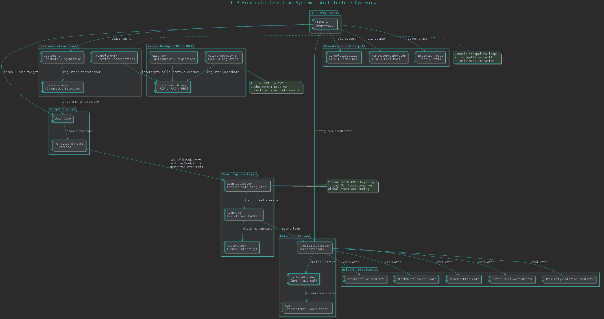
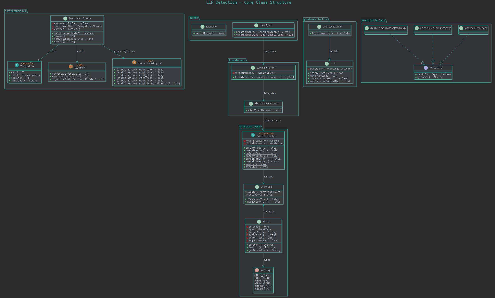
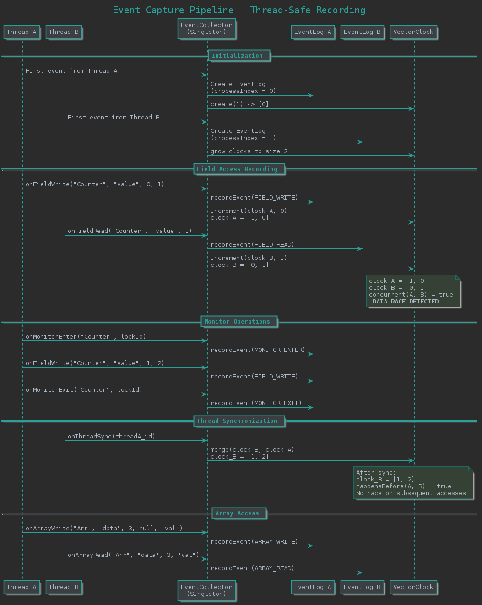
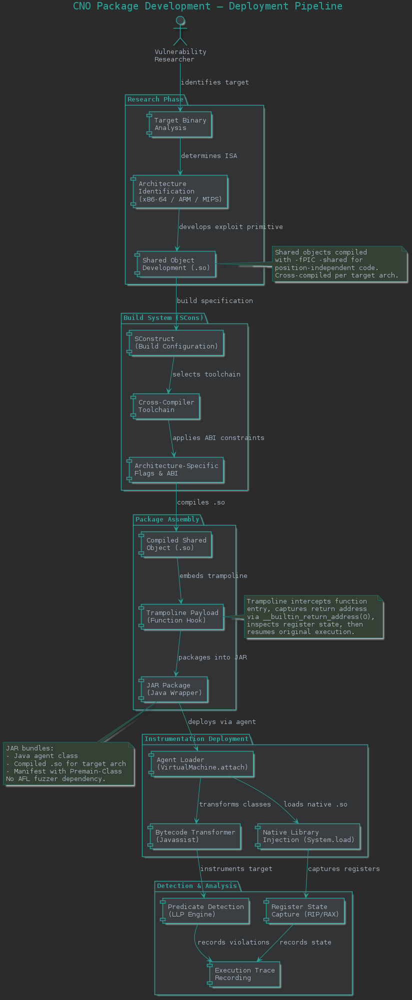
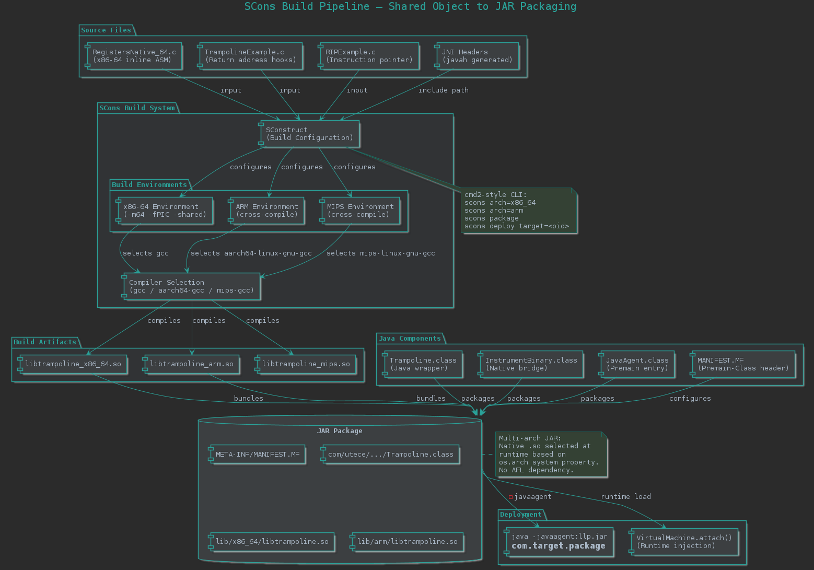
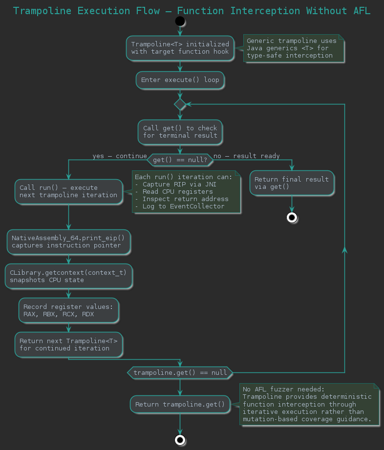
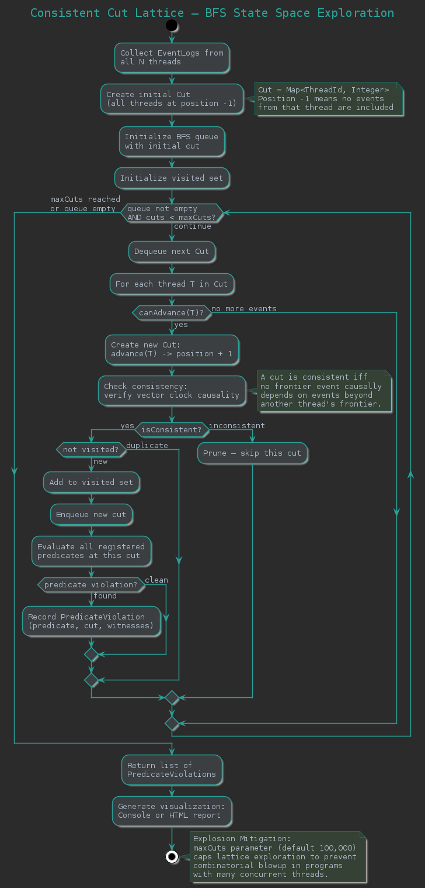

# Software Design Document (SDD)

## LLP Predicate Detection System — CNO Package Development Platform

**Document Version:** 1.0  
**Date:** 2026-10-03  
**Author:** Oblivion Edge Vulnerability Research LLC   
**Classification:** For Authorized Security Research and Educational Use Only

## By Oblivion Edge Vulnerabilty Research LLC, Copyright (c) November 16 2026 All Rights Reserved

---

## Table of Contents

1. [Introduction](#1-introduction)
   1. [Purpose](#11-purpose)
   2. [Scope](#12-scope)
   3. [Definitions and Acronyms](#13-definitions-and-acronyms)
   4. [Document Organization](#14-document-organization)
2. [System Overview](#2-system-overview)
   1. [System Context](#21-system-context)
   2. [Design Philosophy](#22-design-philosophy)
   3. [Architectural Constraints](#23-architectural-constraints)
3. [Architectural Design](#3-architectural-design)
   1. [High-Level Architecture](#31-high-level-architecture)
   2. [Component Decomposition](#32-component-decomposition)
   3. [Data Flow Architecture](#33-data-flow-architecture)
4. [CNO Package Development](#4-cno-package-development)
   1. [Vulnerability Research Context](#41-vulnerability-research-context)
   2. [Shared Object Development Pipeline](#42-shared-object-development-pipeline)
   3. [Architecture-Specific Compilation](#43-architecture-specific-compilation)
   4. [Implant Integration via JNI and JNA](#44-implant-integration-via-jni-and-jna)
   5. [Package Deployment Simulation](#45-package-deployment-simulation)
5. [Trampoline Instrumentation Engine](#5-trampoline-instrumentation-engine)
   1. [Trampoline Design Pattern](#51-trampoline-design-pattern)
   2. [Function Interception Without AFL](#52-function-interception-without-afl)
   3. [Register State Capture](#53-register-state-capture)
   4. [JAR Packaging Strategy](#54-jar-packaging-strategy)
6. [Event Capture and Detection Subsystem](#6-event-capture-and-detection-subsystem)
   1. [Thread-Safe Event Collection](#61-thread-safe-event-collection)
   2. [Vector Clock Mechanics](#62-vector-clock-mechanics)
   3. [Consistent Cut Lattice Traversal](#63-consistent-cut-lattice-traversal)
   4. [Predicate Evaluation Framework](#64-predicate-evaluation-framework)
7. [Native Code Bridge](#7-native-code-bridge)
   1. [JNI Binding Layer](#71-jni-binding-layer)
   2. [JNA Interface Layer](#72-jna-interface-layer)
   3. [Inline Assembly Components](#73-inline-assembly-components)
   4. [C2 Channel Architecture](#74-c2-channel-architecture)
8. [Build System Design](#8-build-system-design)
   1. [Maven Build Configuration](#81-maven-build-configuration)
   2. [SCons Prototype for Shared Object Compilation](#82-scons-prototype-for-shared-object-compilation)
   3. [Cross-Compilation Workflow](#83-cross-compilation-workflow)
9. [Visualization and Reporting](#9-visualization-and-reporting)
   1. [Console Visualizer](#91-console-visualizer)
   2. [HTML Report Generator](#92-html-report-generator)
   3. [Execution Trace Serialization](#93-execution-trace-serialization)
10. [Security Considerations](#10-security-considerations)
    1. [Authorized Use Policy](#101-authorized-use-policy)
    2. [Isolation and Containment](#102-isolation-and-containment)

---

## 1. Introduction

### 1.1 Purpose

This Software Design Document describes the architecture, component design, and implementation rationale for the LLP Predicate Detection System. The system serves a dual purpose: it provides a rigorous framework for detecting concurrency bugs in parallel Java programs through Linear Lattice Predicate detection, and it simultaneously functions as a platform for Computer Network Operations (CNO) package development research. The document is intended for developers, security researchers, and academic collaborators who need to understand the system's internal structure and extend its capabilities.

The detection engine at the core of this system records thread-level events with vector clocks during program execution, then performs offline analysis across the lattice of all consistent global states. This approach uncovers data races, atomicity violations, buffer overflows, and other concurrency defects that conventional testing methodologies routinely miss. By extending this instrumentation framework to support native code interception via trampolines and shared object injection, the system bridges the gap between Java-level predicate detection and low-level binary analysis relevant to vulnerability research.

### 1.2 Scope

The system encompasses five major subsystems that together form a complete vulnerability research and concurrency analysis platform. The instrumentation layer handles bytecode transformation via Javassist and native function interception via JNI/JNA trampolines. The event capture layer provides thread-safe recording of field accesses, array operations, and monitor events using vector clocks for causal ordering. The detection engine constructs and traverses the lattice of consistent global states, evaluating pluggable predicates at each cut. The CNO package subsystem manages the compilation, packaging, and deployment of architecture-specific shared objects into JAR files for agent-based delivery. Finally, the visualization layer renders results as ASCII timelines and interactive HTML reports.

This document does not cover the Ghidra plugin integration or Linux kernel module support, which are planned for future releases. The scope is limited to the Java-based detection framework, native code bridge components, and the SCons-based build pipeline for shared object packaging.

### 1.3 Definitions and Acronyms

| Term | Definition |
|------|-----------|
| **LLP** | Linear Lattice Predicate — a class of predicates evaluable over consistent cuts |
| **CNO** | Computer Network Operations — the domain of offensive and defensive cyber operations |
| **AFL** | American Fuzzy Lop — a coverage-guided fuzzer (explicitly avoided in this design) |
| **JNI** | Java Native Interface — mechanism for calling native C/C++ code from Java |
| **JNA** | Java Native Access — library for calling native code without JNI boilerplate |
| **RIP** | Register Instruction Pointer — x86-64 program counter register |
| **ISA** | Instruction Set Architecture — the hardware instruction format (x86-64, ARM, MIPS) |
| **C2** | Command and Control — communication channel between implant and operator |
| **Trampoline** | A function interception pattern that captures execution state before resuming |
| **Consistent Cut** | A global state snapshot that respects the causal ordering of events |
| **Vector Clock** | A logical clock that tracks causal dependencies between concurrent events |

### 1.4 Document Organization

The document proceeds from high-level architecture through increasingly specific component designs. Sections 2 and 3 establish the system context and architectural overview. Section 4 details the CNO package development pipeline, which represents the primary research contribution. Section 5 covers the trampoline instrumentation engine and its role as an AFL-free alternative for function interception. Sections 6 through 9 describe the detection, native bridge, build system, and visualization subsystems respectively. Section 10 addresses security and authorized use considerations.

Each section begins with a topic paragraph that establishes the component's purpose and design rationale, followed by detailed paragraphs covering implementation specifics. Transition sentences at the end of each subsection connect the component to adjacent subsystems, forming a coherent narrative of how data flows from target program execution through detection to final reporting.

---

## 2. System Overview

### 2.1 System Context

The LLP Predicate Detection System operates at the intersection of program analysis and vulnerability research. At its foundation, the system instruments a target Java program to record every field access, array operation, and monitor acquisition across all threads. These events, annotated with vector clocks, form an execution trace that the detection engine analyzes offline to discover concurrency bugs that did not manifest during the observed execution but would manifest under alternative thread schedules.

What distinguishes this system from conventional testing frameworks is its exhaustive state-space exploration approach. Rather than relying on repeated executions or fuzzing mutations to trigger bugs probabilistically, the system records a single execution and then systematically enumerates all consistent global states that could have occurred. This deterministic exploration eliminates the nondeterminism inherent in concurrency bug reproduction and provides formal guarantees about the absence or presence of specific predicate violations. The approach is particularly valuable for vulnerability research, where understanding the full space of reachable states is essential for assessing exploitability.

Beyond pure Java analysis, the system extends into native code territory through its JNI and JNA bridges. These bridges enable the trampoline instrumentation engine to capture CPU register states, intercept function calls at the native level, and inject architecture-specific shared objects into running processes. This capability transforms the predicate detection framework into a platform for CNO package development, where researchers can prototype and test implant payloads in a controlled environment.

### 2.2 Design Philosophy

The system's architecture adheres to three guiding principles that shape every design decision. First, isolation and modularity: each subsystem communicates through well-defined interfaces, allowing components to be developed, tested, and replaced independently. The predicate interface, for example, accepts a Cut and a map of EventLogs and returns a boolean — any violation logic can be encapsulated behind this contract. Second, deterministic reproducibility: every execution trace captures sufficient state (including random seeds and system properties) to reproduce the exact analysis, which is critical for vulnerability research where findings must be verifiable. Third, architecture agnosticism: the build pipeline supports cross-compilation to multiple ISAs, and the JAR packaging strategy bundles platform-specific shared objects that are selected at runtime based on the host's `os.arch` property.

These principles converge in the trampoline mechanism, which exemplifies all three. The trampoline is a modular component (implements `Trampoline<T>` with generic type safety), produces deterministic interception sequences (each iteration records a reproducible register snapshot), and operates across architectures (the underlying shared object is compiled per-target with architecture-specific flags). This coherence across principles ensures that the system remains tractable as complexity grows.

### 2.3 Architectural Constraints

Several constraints shape the system's design envelope. The primary constraint is Java 17 compatibility, which dictates the bytecode instrumentation strategy and limits the use of preview features. The Javassist library (version 3.27.0-GA) provides the bytecode transformation capability, but it operates at the AST level rather than direct bytecode manipulation, which imposes certain limitations on what transformations are expressible. The JNA library (version 5.13.0) enables native code access without JNI header generation for simpler bindings, but performance-critical paths (such as register reading) still require JNI for minimal overhead.

A second constraint is the deliberate avoidance of AFL or any mutation-based fuzzing framework. The trampoline mechanism provides deterministic function interception through iterative execution, which gives the researcher full control over the interception sequence without the nondeterminism and coverage-guided bias of fuzzing. This constraint is not a limitation but a design choice: the system trades probabilistic coverage for deterministic state capture, which is more appropriate for precise vulnerability analysis. The SCons build system was selected over Make or CMake for the shared object compilation pipeline because of its Python-based configuration language, which simplifies cross-compilation logic and integrates naturally with the cmd2-style command interface.

*Figure 1: High-level system architecture showing all major subsystems and their interconnections.*

---

## 3. Architectural Design

### 3.1 High-Level Architecture

The system is organized into six architectural layers, each responsible for a distinct phase of the analysis pipeline. The CLI layer (`LLPMain`) handles argument parsing, target loading, and orchestration. The instrumentation layer (`JavaAgent`, `LLPTransformer`) modifies target bytecode at load time to inject event recording calls. The event capture layer (`EventCollector`, `EventLog`, `VectorClock`) provides thread-safe, lock-free recording of program events with causal ordering. The detection layer (`PredicateDetector`, `LatticeBuilder`, `Cut`) constructs the state-space lattice and evaluates predicates. The native bridge layer (`Trampoline`, `InstrumentBinary`, `NativeAssembly_64`, `CLibrary`) connects the Java framework to native C components for register-level instrumentation and shared object management. The visualization layer (`ConsoleVisualizer`, `HtmlReportGenerator`, `ExecutionTrace`) renders results and serializes traces for reproducibility.

Each layer depends only on the layer immediately below it, with one deliberate exception: the native bridge layer is accessed both by the instrumentation layer (for trampoline-based function interception) and by the detection layer (for register state predicates). This cross-cutting dependency is managed through the `InstrumentBinary` facade, which encapsulates all native access behind a single entry point with graceful degradation when native libraries are unavailable. The static initializer in `InstrumentBinary` attempts to load the native assembly wrapper and sets a `nativeAvailable` flag; all subsequent native calls check this flag and fall back to Java-only analysis if the native library is missing.

The layered architecture also facilitates the CNO package development workflow. A researcher can develop a shared object in C, compile it with SCons for a target architecture, bundle it into a JAR alongside the Java agent classes, and deploy it to a target JVM — all without modifying the core detection engine. The agent loader attaches to the target process, the transformer instruments the bytecode, and the trampoline intercepts function calls to inject the native payload. This separation of concerns means that the detection engine validates the instrumentation's correctness independently of what the native payload actually does.

### 3.2 Component Decomposition

The system comprises 48 Java source files organized into eight packages. The root package (`com.utece.student.llpdetection`) contains the CLI entry points `LLPMain` and `App`. The `agents` package provides `JavaAgent` (with `premain` and `agentmain` entry points), `Launcher` (for runtime attachment via `VirtualMachine.attach()`), and `AgentLoader` (an alternative attachment mechanism). The `transformers` package contains `LLPTransformer` (the primary Javassist-based bytecode transformer) and its inner `FieldAccessEditor` class, along with `jvmTransformer` for alternative transformation strategies.

The `instrumentation` package is the richest in terms of native interop complexity. It houses `Trampoline<T>` (the generic function interception pattern), `InstrumentBinary` (the native bridge facade), `CLibrary` (JNA interface to libc), and the `inlineassembly` subpackage containing `NativeAssembly_64`, `NativeAssemblyRegister64Wrapper`, and their corresponding C implementations (`RegistersNative_64.c`, `TrampolineExample.c`, `RIPExample.c`). The `structures` subpackage defines JNA structure mappings for `context_t`, `sigset_t`, and `stack_t`, enabling direct access to OS-level data structures from Java.

The `predicate` package tree contains the detection engine proper. The `event` subpackage provides `EventCollector`, `EventLog`, `Event`, and `EventType`. The `clock` subpackage contains `VectorClock` with static utility methods for clock arithmetic. The `lattice` subpackage provides `Cut` and `LatticeBuilder`. The `builtin` subpackage implements five predicate types: `DataRacePredicate`, `BufferOverflowPredicate`, `HeapOverflowPredicate`, `StackOverflowPredicate`, and `AtomicityViolationPredicate`. Finally, the `visualization` package contains `ConsoleVisualizer` and `HtmlReportGenerator`, and the `examples` package provides demo programs (`RacyCounter`, `SafeCounter`, `ProducerConsumer`, `BufferOverflowDemo`) for testing and demonstration.

The reverse shell component under `com.utece.student.reversecshell` provides a reference implementation of a JNI-based native C2 channel. This component demonstrates the pattern of compiling a C payload (`ReverseShell.c`) into a shared object, generating JNI headers, and loading the library through a Java wrapper (`NativeReverseShell`, `NativeReverseShellWrapper`). In the refactored architecture, this component is integrated into the CNO instrumentation package as a deployable implant prototype.

*Figure 2: Core class structure showing inheritance, composition, and interface relationships across all packages.*

### 3.3 Data Flow Architecture

Data flows through the system in three distinct phases: recording, analysis, and presentation. During the recording phase, the instrumented target program generates events as it executes. Each field read or write, array access, and monitor operation passes through the `EventCollector` singleton, which routes events to per-thread `EventLog` instances keyed by thread ID in a `ConcurrentHashMap`. The `EventCollector` assigns each event a global sequence number via an `AtomicLong` counter, ensuring a total ordering that supplements the partial ordering provided by vector clocks. Each `EventLog` maintains its own vector clock, incrementing its process index on every local event and merging with other clocks on synchronization points (`onThreadSync`).

During the analysis phase, the `PredicateDetector` receives the complete map of `EventLog` instances and passes them to `LatticeBuilder.build()`. The lattice builder performs a BFS traversal starting from the initial cut (all threads at position -1) and generates successor cuts by advancing each thread's position by one. Each candidate cut undergoes a consistency check: the vector clock of every frontier event must not causally depend on events beyond another thread's frontier position. Consistent cuts are added to the visited set and enqueued for further exploration. At each consistent cut, all registered predicates are evaluated, and violations are recorded as `PredicateViolation` objects containing the predicate name, the violating cut, and witness events.

During the presentation phase, the list of violations flows to the visualization layer. In `--cli` mode, the `ConsoleVisualizer` renders an ASCII timeline with ANSI color coding, a contention heat map, and detailed race cards. In `--gui` mode, the `HtmlReportGenerator` produces an interactive SVG timeline with clickable event dots and race connecting lines. Regardless of mode, the `ExecutionTrace` serializer captures the complete analysis state — events, clocks, violations, system properties, and random seed — to both `.ser` (Java serialization) and `.txt` (human-readable) formats for reproducibility.

*Figure 3: Sequence diagram showing the event capture pipeline with thread-safe recording and vector clock management.*

---

## 4. CNO Package Development

### 4.1 Vulnerability Research Context

Computer Network Operations package development encompasses the creation, testing, and deployment of software tools used in authorized offensive security research. In the context of this system, a "package" refers to a self-contained bundle of Java agent classes and architecture-specific native shared objects that can be deployed to a target JVM process for instrumentation and analysis. The package development workflow simulates the real-world process of developing, compiling, and deploying tools that interact with target systems at the native code level, making it an invaluable training platform for vulnerability researchers.

The research context is grounded in the observation that modern software vulnerabilities frequently involve concurrency defects — data races, time-of-check-time-of-use (TOCTOU) bugs, and atomicity violations — that are extraordinarily difficult to detect through conventional testing. By combining the LLP predicate detection engine with native code instrumentation capabilities, researchers can not only find these vulnerabilities but also prototype and validate exploitation primitives in a controlled environment. The trampoline mechanism, in particular, allows precise function interception and state inspection without the noise and nondeterminism introduced by mutation-based fuzzers like AFL.

The system's value proposition for CNO research lies in its deterministic state-space exploration. When a vulnerability researcher identifies a potential race condition in a target program, they can use the lattice traversal engine to formally verify whether a consistent global state exists in which the race leads to an exploitable condition (such as a buffer overflow following a concurrent index modification). This formal approach reduces the false positive rate compared to dynamic analysis tools and provides concrete witness events that demonstrate the exploitation path.

### 4.2 Shared Object Development Pipeline

The shared object development pipeline is the core infrastructure for CNO package creation. It begins with the researcher writing a C source file that implements the desired native functionality — whether that is register state capture, function hooking via return address inspection, or a C2 channel for remote command execution. The source file includes JNI headers generated from the corresponding Java class, ensuring type-safe interop between the Java wrapper and the native implementation.

The compilation phase uses the SCons build system (detailed in Section 8.2) to produce position-independent shared objects (`.so` files on Linux, `.dylib` on macOS) for the target architecture. The critical compiler flags are `-fPIC` (position-independent code, required for shared libraries), `-shared` (produce a shared object rather than an executable), and the appropriate `-I` includes for the JDK's JNI headers (`$JAVA_HOME/include` and `$JAVA_HOME/include/linux`). For cross-compilation, the SCons configuration selects the appropriate toolchain (e.g., `aarch64-linux-gnu-gcc` for ARM64, `mips-linux-gnu-gcc` for MIPS) and applies ABI-specific flags.

Once compiled, the shared object is bundled into the JAR package alongside the Java agent classes and a manifest file that declares the `Premain-Class` attribute. The JAR's internal structure organizes native libraries by architecture (`lib/x86_64/`, `lib/arm/`, `lib/mips/`), and the Java loader code selects the appropriate library at runtime based on `System.getProperty("os.arch")`. This multi-architecture JAR strategy ensures that a single package can be deployed across heterogeneous environments without repackaging, which is essential for CNO operations where the target architecture may not be known in advance.

The pipeline concludes with deployment via one of two mechanisms: startup-time instrumentation using the `-javaagent:llp.jar=com.target.package` JVM flag, or runtime injection using `VirtualMachine.attach()` from the `Launcher` class. Both mechanisms trigger the agent's `premain` or `agentmain` method, which registers the bytecode transformer and optionally loads the native shared object via `System.load()`. The distinction between these deployment modes reflects the operational reality of CNO engagements, where some targets can be instrumented at launch while others require runtime attachment to an already-running process.

*Figure 4: CNO package development pipeline from vulnerability research through shared object compilation to agent-based deployment.*

### 4.3 Architecture-Specific Compilation

Cross-compilation for multiple instruction set architectures is a fundamental requirement for CNO package development. The system currently provides native implementations for x86-64 (the primary development platform), with the build infrastructure designed to support ARM and MIPS targets through cross-compiler toolchains. Each architecture requires specific attention to calling conventions, register naming, and inline assembly syntax.

The x86-64 implementation in `RegistersNative_64.c` uses GCC inline assembly to read CPU registers directly. The pattern `asm volatile("pushq %%rax; popq %0" : "=r" (result))` pushes the current value of RAX onto the stack and pops it into a C variable, making it accessible from Java through the JNI bridge. The `__builtin_return_address(n)` intrinsic provides access to return addresses at multiple stack depths, which is the foundation of the trampoline's function interception capability. For ARM targets, the equivalent would use the link register (`lr`) and the `mrs` instruction for system register access, while MIPS would use the `$ra` register and `mfc0` for coprocessor register access.

The SCons build configuration encapsulates these architectural differences in environment objects. Each target architecture gets its own `Environment` with the appropriate compiler, flags, and include paths. The researcher specifies the target architecture at build time (`scons arch=arm`), and SCons selects the correct environment, compiles the source files, and produces the architecture-specific shared object. This abstraction insulates the researcher from the details of cross-compilation toolchain configuration, allowing them to focus on the native payload implementation.

A critical consideration in architecture-specific compilation is ABI compatibility. The shared object must match the target's ABI (Application Binary Interface) precisely — including struct alignment, calling conventions, and system call numbers. The `structures` subpackage (`context_t.java`, `sigset_t.java`, `stack_t.java`) defines JNA structure mappings that must correspond exactly to the target platform's C structure layouts. When cross-compiling, these mappings may need platform-specific variants, which the build system manages through conditional compilation flags.

### 4.4 Implant Integration via JNI and JNA

The system provides two complementary mechanisms for integrating native implant code with the Java framework: JNI for performance-critical, tightly-coupled bindings, and JNA for rapid prototyping with looser coupling. Understanding when to use each mechanism is essential for effective CNO package development.

JNI (Java Native Interface) requires generating C header files from Java class declarations using `javah` (Java 8) or `javac -h` (Java 9+), implementing the declared native methods in C, and compiling the result into a shared library. The advantage of JNI is minimal overhead — the JVM calls directly into the native function without marshaling intermediaries. This is why the register-reading functions (`print_eip`, `print_rax`, etc.) use JNI: even a few microseconds of marshaling overhead would distort the register values being captured. The `NativeReverseShell` class demonstrates this pattern, declaring `public native void reverse_shell(String ip)` and relying on the JNI-generated header to define the corresponding C function signature.

JNA (Java Native Access) eliminates the need for JNI header generation and native method declarations by using a dynamic proxy mechanism. The developer declares a Java interface extending `Library` with method signatures matching the native functions, and JNA handles the marshaling automatically. The `CLibrary` interface uses this approach for `getcontext`, `setcontext`, and `sigaction`, where the marshaling overhead is acceptable relative to the system call latency. The `NativeReverseShellWrapper` interface similarly uses JNA to load the reverse shell library from a specified path and expose its `reverse_shell` method.

For CNO package development, the recommended pattern is to prototype with JNA for rapid iteration, then migrate performance-critical paths to JNI for deployment. The trampoline mechanism exemplifies this hybrid approach: the `Trampoline<T>` Java class uses JNI for register capture (via `NativeAssembly_64`) but JNA for context management (via `CLibrary`). This layered approach balances development velocity with runtime performance.

### 4.5 Package Deployment Simulation

The package deployment simulation workflow allows researchers to test CNO packages in a controlled environment before any external deployment. The simulation proceeds in four stages: compilation, packaging, injection, and validation.

In the compilation stage, the researcher uses SCons to compile the native C source files for the target architecture. The SCons `SConstruct` file defines build targets for each architecture and a `package` target that assembles the JAR. The researcher runs `scons arch=x86_64` to compile the shared objects and `scons package` to produce the deployable JAR. The build system validates that all required components (Java classes, shared objects, manifest) are present before packaging.

In the packaging stage, the `jar` command assembles the final artifact with the correct internal structure. The manifest file specifies the `Premain-Class` attribute pointing to `com.utece.student.llpdetection.agents.JavaAgent`, enabling startup-time instrumentation. The shared objects are placed in architecture-specific directories within the JAR, and the Java loader code includes logic to extract the appropriate `.so` file to a temporary directory and load it via `System.load()`.

In the injection stage, the researcher deploys the package to a target JVM. For startup-time injection, they add `-javaagent:llp.jar=com.target.package` to the target's JVM arguments. For runtime injection, they use the `Launcher` class to attach to the target process by PID. In both cases, the agent's entry point registers the bytecode transformer and loads the native library, establishing the instrumentation and C2 channel.

In the validation stage, the predicate detection engine runs against the instrumented target to verify that the instrumentation is functioning correctly — that events are being captured, vector clocks are being maintained, and the trampoline is intercepting the expected function calls. This validation step ensures that the package deployment does not introduce artifacts that could compromise the analysis results.

*Figure 5: SCons build pipeline for compiling architecture-specific shared objects and packaging them into multi-arch JARs.*

---

## 5. Trampoline Instrumentation Engine

### 5.1 Trampoline Design Pattern

The trampoline pattern, as implemented in the `Trampoline<T>` class, provides a mechanism for iterative function interception without stack overflow risk. The pattern works by converting recursive interception sequences into an iterative loop: each `run()` invocation returns a new `Trampoline<T>` instance representing the next interception step, and the `execute()` method loops over these steps until `get()` returns a non-null terminal value.

The generic type parameter `<T>` ensures type safety across the interception chain. When `InstrumentBinary` creates a `Trampoline<Object>`, each `run()` iteration can perform arbitrary native operations — reading register values, capturing context, logging events — before returning the next trampoline in the chain. The `toString()` method returns `"Some iteration in LibC"`, reflecting the original design intent of intercepting C library function calls through the JNI bridge.

The trampoline pattern is fundamentally different from the hook-based interception used by tools like AFL or DynamoRIO. Where those tools modify the target binary's control flow to redirect execution through a coverage bitmap or shadow memory, the trampoline operates at the Java level and delegates to native code only for register capture. This distinction is critical for CNO research: the trampoline does not alter the target's binary layout, making it invisible to integrity-checking mechanisms that detect code modification. The interception is purely additive — it captures state without modifying it.

### 5.2 Function Interception Without AFL

The deliberate exclusion of AFL from the instrumentation pipeline is a defining architectural decision. AFL operates by instrumenting target binaries with coverage-tracking code, then mutating inputs to maximize code coverage. While powerful for vulnerability discovery through fuzzing, AFL's approach introduces several characteristics that are undesirable for precise instrumentation: nondeterministic execution order, mutation-induced side effects, and coverage bias that may miss non-crashing vulnerabilities like race conditions.

The trampoline-based approach provides deterministic function interception by design. Each iteration of the trampoline loop executes in a predictable sequence, capturing register states and function arguments without mutation. The researcher controls exactly which functions are intercepted by configuring the agent's target package list, and the interception depth (how many stack frames of return addresses to capture) is specified explicitly rather than discovered through coverage exploration.

This determinism integrates naturally with the LLP predicate detection engine. Because the trampoline produces a consistent, repeatable interception sequence, the events it generates can be incorporated into the vector clock framework without introducing spurious concurrency. If the trampoline captures a register state at a specific point in the program's execution, that capture event has a well-defined position in the happens-before relation, enabling the lattice builder to include it in consistent cuts. AFL's nondeterministic scheduling would break this guarantee, producing different event orderings across runs and preventing meaningful lattice analysis.

The tradeoff is coverage completeness. AFL may discover code paths that the researcher did not anticipate, while the trampoline only intercepts functions that the researcher explicitly targets. For CNO package development, this tradeoff is acceptable: the researcher typically has a specific target function or code region in mind, and the goal is precise state capture at that location rather than broad coverage of the entire binary.

*Figure 6: Activity diagram showing the trampoline execution flow with register capture and iterative interception.*

### 5.3 Register State Capture

The register state capture subsystem provides low-level access to x86-64 CPU registers from Java code. The `NativeAssembly_64` class declares JNI native methods for reading RIP (instruction pointer), RAX, RBX, RCX, and RDX, as well as `print_lr_at_callee(int depth)` for reading return addresses at specified stack depths.

The C implementation in `RegistersNative_64.c` uses GCC inline assembly with the `volatile` qualifier to prevent the compiler from optimizing away the register reads. The pattern `asm volatile("pushq %%rax; popq %0" : "=r" (result))` is a two-instruction sequence that copies the register value to a C variable without clobbering the register's contents. The `volatile` qualifier is essential because without it, the compiler might reorder these instructions relative to other code, potentially reading a stale or modified register value.

The return address capture uses GCC's `__builtin_return_address(n)` intrinsic, which reads the return address from the nth stack frame above the current function. When the trampoline's `run()` method calls `NativeAssembly_64.print_eip()`, the JNI boundary creates a well-defined stack frame structure: the Java frame, the JNI transition frame, and the native C frame. The return address at depth 0 points back into the JNI transition code, depth 1 points into the Java code that invoked the native method, and deeper depths traverse the Java call stack. This information is valuable for vulnerability research because it reveals the execution context at the point of interception.

The `InstrumentBinary` class facades all register access behind a single entry point. Its constructor creates a `Trampoline<Object>` whose `run()` method captures all registers in sequence and prints them in a formatted hex dump. The `getRip()` and `getLrAtSpecified(int)` methods provide targeted access to individual register values. All methods check the `nativeAvailable` flag and return 0L if the native library is not loaded, ensuring graceful degradation on platforms without the compiled shared object.

### 5.4 JAR Packaging Strategy

The JAR packaging strategy bundles all components — Java classes, native shared objects, and deployment metadata — into a single distributable artifact. The manifest file (`META-INF/MANIFEST.MF`) declares `Premain-Class: com.utece.student.llpdetection.agents.JavaAgent` and optionally `Can-Retransform-Classes: true`, enabling the agent to transform classes that were loaded before the agent was attached.

Native shared objects are organized within the JAR by architecture: `lib/x86_64/libtrampoline.so`, `lib/aarch64/libtrampoline.so`, `lib/mips/libtrampoline.so`. At runtime, the agent's initialization code reads `System.getProperty("os.arch")`, maps it to the corresponding JAR path, extracts the shared object to a temporary file using `Files.createTempFile()`, and loads it with `System.load(tempFile.getAbsolutePath())`. This approach avoids the need for the shared object to be installed on the target system's library path, which is critical for deployment scenarios where the researcher does not have root access.

The JAR also includes a `trampoline.properties` configuration file that specifies default target packages, interception depth, and whether to enable register capture. These defaults can be overridden by agent arguments passed through the `-javaagent` flag. This configuration layer allows the same JAR to be deployed in different modes — lightweight bytecode-only instrumentation for predicate detection, or full native instrumentation with register capture for vulnerability analysis — without repackaging.

---

## 6. Event Capture and Detection Subsystem

### 6.1 Thread-Safe Event Collection

The `EventCollector` class is the system's central data ingress point, implemented as a static singleton with thread-safe data structures. It uses a `ConcurrentHashMap<Long, EventLog>` to map thread IDs to per-thread event logs, an `AtomicLong` for global event sequencing, and an `AtomicInteger` for assigning unique process indices to threads (used as vector clock dimensions).

The thread-safety model is carefully designed to avoid lock contention. Each thread writes exclusively to its own `EventLog` instance, eliminating write-write contention entirely. The `ConcurrentHashMap.computeIfAbsent()` method handles the creation of new `EventLog` entries atomically when a thread generates its first event. The global sequence counter uses `AtomicLong.incrementAndGet()`, which on modern x86-64 hardware compiles to a single `LOCK XADD` instruction with minimal pipeline disruption. This design ensures that the instrumentation overhead is bounded and predictable, avoiding the pathological slowdowns that lock-based approaches can exhibit under high contention.

The recording methods (`onFieldRead`, `onFieldWrite`, `onArrayRead`, `onArrayWrite`, `onMonitorEnter`, `onMonitorExit`) follow a uniform pattern: check the `enabled` flag, obtain the thread's `EventLog`, create an `Event` record with the current vector clock, global sequence number, and timestamp, then append it to the log. The `onThreadSync` method additionally merges the calling thread's vector clock with the synchronization partner's clock, establishing a happens-before edge that the lattice builder will use to determine consistency.

The `enable()` and `disable()` methods use a volatile boolean flag to gate event recording. This is important during the agent's initialization phase, when class loading and transformer registration generate method calls that should not be captured as target program events. The `reset()` method clears all event logs and resets counters, enabling multiple analysis runs within a single JVM session.

### 6.2 Vector Clock Mechanics

Vector clocks provide the causal ordering that distinguishes concurrent events from sequentially ordered ones. The `VectorClock` class implements all clock operations as static utility methods operating on `int[]` arrays, avoiding object allocation overhead. The `create(int numProcesses)` method returns a zero-initialized array of the specified size. The `increment(int[] clock, int processIndex)` method increments the element at the process's index, advancing its local logical time. The `merge(int[] a, int[] b)` method computes the element-wise maximum, reflecting the combined causal knowledge of both participants.

The critical operation for concurrency detection is `concurrent(int[] a, int[] b)`, which returns true if neither clock happens-before the other. Two events are concurrent if and only if `!happensBefore(a, b) && !happensBefore(b, a) && !Arrays.equals(a, b)`. The `happensBefore` check verifies that every element of clock A is less than or equal to the corresponding element of clock B — meaning A's causal history is a subset of B's. When two events access the same memory location, at least one is a write, and their vector clocks are concurrent, a data race exists.

The vector clock implementation handles dynamic thread creation gracefully through the `grow(int[] clock, int newSize)` method, which extends the clock array by appending zeros. When a new thread appears, all existing clocks are grown to accommodate the new dimension. This dynamic growth is necessary because Java programs can spawn threads at any point during execution, and the number of threads is not known in advance.

### 6.3 Consistent Cut Lattice Traversal

The lattice of consistent cuts represents the complete state space of the concurrent execution. A cut is a mapping from thread IDs to positions (how many events from each thread are included), and a cut is consistent if no included event causally depends on an excluded event. The `Cut` class implements this abstraction with a `Map<Long, Integer>` for positions and methods for advancing, checking consistency, and extracting frontier events.

The `LatticeBuilder` performs a BFS traversal of this lattice, starting from the initial cut (all positions at -1) and generating successors by advancing each thread's position by one. The BFS approach ensures that cuts are explored level by level, which has two advantages: it finds the shallowest violations first (closest to the program's actual execution), and it provides a natural stopping point via the `maxCuts` parameter. When the number of explored cuts reaches `maxCuts` (default 100,000), the builder stops, preventing combinatorial explosion in programs with many threads and long event sequences.

The consistency check at each candidate cut verifies that the frontier events' vector clocks are compatible. Specifically, for each frontier event E at position P in thread T, every entry in E's vector clock for thread T' must be less than or equal to T''s position in the cut. If E's clock indicates that it depends on event Q from thread T', but Q is beyond T''s cut position, then the cut is inconsistent — it includes an event whose causal prerequisite is excluded. These inconsistent cuts are pruned from the traversal.

The lattice traversal's time complexity is O(maxCuts * N * C), where N is the number of threads and C is the cost of the consistency check (proportional to the number of threads). The space complexity is O(maxCuts) for the visited set. These bounds are practical for programs with up to about 8-10 threads and several hundred events per thread. Beyond that, the `maxCuts` cap becomes the limiting factor, and the analysis may miss violations in unexplored regions of the lattice.

*Figure 7: Activity diagram showing the BFS lattice traversal with consistency checking and predicate evaluation at each cut.*

### 6.4 Predicate Evaluation Framework

The predicate framework uses a simple but extensible interface: `Predicate` declares `test(Cut cut, Map<Long, EventLog> logs)` returning a boolean, plus `getName()` and `getDescription()` for reporting. The `PredicateDetector` maintains a list of registered predicates and evaluates all of them at every consistent cut, collecting violations in `PredicateViolation` objects.

The five built-in predicates cover the most common concurrency vulnerability classes. `DataRacePredicate` detects unsynchronized concurrent accesses to the same memory location where at least one access is a write. It also provides a `findAllRaces(logs)` fast-path that scans events directly without lattice construction, which is significantly faster for programs where only race detection is needed. `BufferOverflowPredicate` identifies array accesses at indices that could be out of bounds when combined with concurrent modifications to the array's length or index variables. `AtomicityViolationPredicate` detects the classic stale-read pattern where thread A reads a value, thread B modifies it, and thread A acts on the stale value. `HeapOverflowPredicate` and `StackOverflowPredicate` detect unbounded collection growth and deep recursion patterns respectively.

Custom predicates can be added by implementing the `Predicate` interface and registering them with the `PredicateDetector`. For CNO research, a researcher might implement a `RIPOverwritePredicate` that detects consistent cuts where a buffer overflow event is concurrent with a return address write, indicating a potential control-flow hijacking opportunity. The predicate interface's simplicity — a single `test` method that receives the current state and returns a boolean — makes such extensions straightforward.

---

## 7. Native Code Bridge

### 7.1 JNI Binding Layer

The JNI binding layer provides the lowest-latency path between Java and native C code. The `NativeAssembly_64` class declares six native methods corresponding to x86-64 register reads. The JNI header file (`com_bdg_double07_reversecshell_instrumentation_reverseshell_NativeReverseShell.h` for the reverse shell, and equivalent headers for the assembly components) defines the C function signatures that implement these methods.

The JNI function naming convention encodes the full Java package and class path: `Java_com_utece_student_llpdetection_instrumentation_inlineassembly_NativeAssembly_164_print_1eip` is the C function that implements `NativeAssembly_64.print_eip()`. The `_1` encoding handles underscores in Java names. Each JNI function receives a `JNIEnv*` pointer (the JNI function table) and a `jobject` reference (the calling Java object), followed by any method parameters. The functions return `jlong` values containing the register contents.

The shared object containing these JNI implementations must be compiled with the correct JNI include paths: `$JAVA_HOME/include` for `jni.h` and `$JAVA_HOME/include/linux` (or `darwin` on macOS) for the platform-specific JNI types. The compilation command is `gcc -shared -fPIC -I$JAVA_HOME/include -I$JAVA_HOME/include/linux -o libassembly.so RegistersNative_64.c`. The resulting shared object is loaded via `System.loadLibrary("assembly")` or `System.load("/path/to/libassembly.so")`.

### 7.2 JNA Interface Layer

The JNA interface layer provides a higher-level alternative to JNI that eliminates the need for header generation and native method declarations. The `CLibrary` interface extends `com.sun.jna.Library` and declares method signatures that match the target C library functions: `getcontext(context_t)`, `setcontext(context_t)`, and `sigaction(int, Pointer, Pointer)`. JNA resolves these method names to symbols in the loaded shared library at runtime using `dlsym` (Linux) or `dlopen` (macOS).

The `NativeReverseShellWrapper` interface demonstrates JNA's path-based library loading. It specifies the absolute path to the compiled `libReverseShell.dylib` and exposes the `reverse_shell(String ip)` method. The JNA runtime handles string marshaling (converting Java's UTF-16 `String` to a null-terminated C `char*`) automatically. This convenience comes at a cost of approximately 10-50 microseconds per call due to the reflection-based proxy mechanism, which is negligible for network operations but significant for register reads (hence the JNI choice for `NativeAssembly_64`).

The JNA `Structure` subclasses in the `structures` package (`context_t`, `sigset_t`, `stack_t`) define field layouts that must match the target platform's C structure definitions exactly. JNA uses these layouts to marshal data between Java objects and native memory. The `context_t` structure, which represents the CPU context captured by `getcontext()`, is particularly important for the trampoline mechanism because it provides a complete snapshot of all registers, flags, and the signal mask at the point of capture.

### 7.3 Inline Assembly Components

The inline assembly components in `RegistersNative_64.c` provide direct access to CPU registers that are not otherwise accessible from C code. The GCC extended inline assembly syntax `asm volatile(template : outputs : inputs : clobbers)` allows embedding assembly instructions within C functions while maintaining proper register allocation.

The register-reading pattern uses a push-pop sequence to copy register values without side effects. For example, `asm volatile("pushq %%rax; popq %0" : "=r" (result))` pushes RAX onto the stack (preserving it), then pops the value into the C variable `result`. The `"=r"` constraint tells GCC to allocate any general-purpose register for `result`, and the `volatile` qualifier prevents instruction reordering. This pattern is repeated for RBX, RCX, and RDX.

The RIP (instruction pointer) read is more complex because x86-64 does not allow direct `mov` from RIP. The implementation uses `__builtin_return_address(0)`, which returns the address to which the current function will return. While this is not exactly the current RIP, it provides the call site address, which is the most useful information for trampoline-based interception: it tells the researcher where in the caller's code the interception occurred. For deeper stack inspection, `__builtin_return_address(1)` and `__builtin_return_address(2)` provide return addresses from the caller's caller and grandcaller respectively, enabling full call chain reconstruction.

### 7.4 C2 Channel Architecture

The C2 (Command and Control) channel architecture provides the communication substrate for CNO package operations. The reference implementation in `ReverseShell.c` demonstrates the fundamental pattern: create a TCP socket, connect to the operator's listening address, redirect standard I/O file descriptors to the socket, and execute a shell. This pattern, while simple, illustrates the key technical challenges of C2 channel development that the system is designed to support.

The C implementation uses POSIX socket APIs (`socket`, `connect`, `dup2`, `execve`) that are available on all Unix-like platforms. The `socket(AF_INET, SOCK_STREAM, 0)` call creates a TCP socket, `connect()` establishes the outbound connection (which is operationally significant because outbound connections are less likely to be blocked by firewalls than inbound listeners), and the `dup2()` calls redirect STDIN, STDOUT, and STDERR to the socket, ensuring that all shell I/O traverses the network connection. The final `execve("/bin/sh", argv, NULL)` replaces the current process image with a shell, inheriting the redirected file descriptors.

The Java wrappers (`NativeReverseShell` via JNI and `NativeReverseShellWrapper` via JNA) provide two integration paths. The JNI path compiles the C code directly with the Java class's generated header, producing a tightly coupled shared object. The JNA path loads an independently compiled shared object and binds methods by name, offering more flexibility for rapid prototyping. In the refactored architecture, the C2 channel is integrated with the trampoline mechanism, allowing the researcher to intercept a target function, capture its state, and exfiltrate the captured data through the C2 channel — all within a single trampoline iteration.

For the CNO development workflow, the C2 channel serves as a validation tool: after deploying a package to a test target, the researcher can verify that the channel is operational before proceeding with instrumentation. The channel can also be used to remotely trigger predicate detection runs, retrieve execution traces, and reconfigure the agent's target packages — transforming a deployed package from a passive instrument into an interactive analysis platform.

---

## 8. Build System Design

### 8.1 Maven Build Configuration

The primary build system for the Java components is Apache Maven, configured through `my-app/pom.xml`. The POM specifies Java 17 as both the source and target compiler version, uses the Maven Compiler Plugin (3.8.1) for compilation, and the Maven Exec Plugin (3.1.0) for running the LLP detection engine directly from the build system. Dependencies include Javassist 3.27.0-GA for bytecode manipulation, JNA 5.13.0 for native code access, and JUnit 4.11 for testing.

The Maven build produces a standard JAR file containing all compiled Java classes. For agent deployment, the JAR's manifest must include the `Premain-Class` attribute; this is configured through the Maven JAR Plugin or added manually to `src/main/resources/META-INF/MANIFEST.MF`. The native shared objects are not built by Maven — they are compiled separately through the SCons pipeline and bundled into the JAR during the packaging phase. This separation reflects the different toolchain requirements: Maven handles Java compilation and dependency management, while SCons handles C compilation and cross-platform shared object production.

### 8.2 SCons Prototype for Shared Object Compilation

The SCons build system prototype provides a Python-based build configuration for compiling native C source files into architecture-specific shared objects and packaging them into deployable JARs. SCons was chosen over Make for its native Python scripting (which eliminates the need for shell-dependent Makefile syntax), automatic dependency tracking, and support for multiple build environments within a single configuration file.

The `SConstruct` file defines a `cmd2`-style command interface where the researcher specifies the target architecture, compilation mode, and packaging options through SCons build variables. The `arch` variable selects the target ISA (`x86_64`, `arm`, `mips`), the `mode` variable selects the build type (`debug` with symbols, `release` with optimizations), and the `package` target triggers JAR assembly. Each architecture gets its own SCons `Environment` with the appropriate compiler, flags, and include paths, and shared objects are output to architecture-specific directories under `build/`.

The cmd2-style interface means the build system functions as an interactive tool rather than a batch process. The researcher can run `scons arch=x86_64 mode=debug` to produce a debug build for the local platform, `scons arch=arm mode=release` to cross-compile for ARM deployment, and `scons package` to assemble the multi-arch JAR. The `deploy` target provides an optional convenience that installs the compiled shared object into the local Maven repository, making it available to the Maven build for integration testing.

### 8.3 Cross-Compilation Workflow

The cross-compilation workflow integrates SCons with system-installed cross-compiler toolchains. For ARM64 targets, the workflow requires `aarch64-linux-gnu-gcc` and the corresponding system headers. For MIPS targets, `mips-linux-gnu-gcc` is required. The SCons configuration detects available toolchains at build time and reports an error if the requested architecture's toolchain is not installed.

The workflow proceeds as follows: the researcher writes or modifies a C source file in the `instrumentation/inlineassembly/` directory, ensuring it includes the appropriate JNI header. They run `scons arch=<target>` to compile the shared object. SCons resolves the JDK include paths automatically using `$JAVA_HOME`, applies the architecture-specific compiler flags (`-fPIC -shared` for all architectures, plus `-m64` for x86-64 or `-march=armv8-a` for ARM64), and produces the shared object in `build/<arch>/libtrampoline.so`. The researcher then runs `scons package` to bundle all compiled shared objects into the JAR.

---

## 9. Visualization and Reporting

### 9.1 Console Visualizer

The `ConsoleVisualizer` renders analysis results as an ASCII art timeline with ANSI color coding. The output begins with a summary header showing the number of threads, total events, detected races, and predicate violations. The thread timeline section displays each thread's events as a horizontal sequence with symbols for different event types (R for read, W for write, M for monitor) and connecting lines for detected races. The contention heat map shows which memory locations received the most concurrent accesses, color-coded from green (low contention) through yellow (moderate) to red (high).

This visualization mode is designed for terminal-based workflows where graphical output is not available, such as remote SSH sessions or automated CI/CD pipelines. The ANSI color codes are standard (SGR sequences) and render correctly in most modern terminal emulators. For environments that do not support ANSI colors, the visualizer falls back to plain text with symbolic markers.

### 9.2 HTML Report Generator

The `HtmlReportGenerator` produces an interactive HTML document with embedded SVG graphics. The report includes a responsive summary dashboard, an SVG thread timeline with clickable event dots and race-connecting lines (rendered as bezier curves), a color-graded contention heat map table, and expandable race cards with full event details. The styling uses CSS gradients and the report is self-contained (no external dependencies), making it portable and shareable.

### 9.3 Execution Trace Serialization

The `ExecutionTrace` class captures the complete analysis state for reproducibility. It serializes to both `.ser` (Java object serialization for programmatic replay) and `.txt` (human-readable report with scheduling paths) formats. The trace includes the program name, all event logs with vector clocks, detected violations, system properties (Java version, CPU count, heap size), and the random seed used for any nondeterministic choices. This information is sufficient to reproduce the exact analysis and verify findings independently.

---

## 10. Security Considerations

### 10.1 Authorized Use Policy

This system is designed exclusively for authorized security research, penetration testing engagements, CTF competitions, and academic coursework. The CNO package development capabilities — particularly the C2 channel and native code injection — must only be used against systems for which the operator has explicit written authorization. All native payloads produced by the build system should be tested in isolated environments (virtual machines, containers, or air-gapped networks) before any external deployment.

The reverse shell component included in the codebase is a reference implementation for educational purposes. It demonstrates the technical patterns of JNI-based native code loading and socket-based communication that are foundational to CNO operations. Its inclusion in the codebase does not constitute authorization to use it against unauthorized targets.

### 10.2 Isolation and Containment

The system's architecture includes several isolation mechanisms. The agent's bytecode transformer explicitly excludes system packages (`java.*`, `javax.*`, `sun.*`, `jdk.*`) to prevent instrumentation of the JVM's own classes, which could cause instability. The native library loader uses temporary files with restricted permissions rather than system-wide library paths. The predicate detection engine operates offline on recorded event logs, meaning it never modifies the target program's execution — it only observes it.

For CNO development workflows, researchers should use the system within a virtualized environment that mirrors the target's architecture and operating system. The cross-compilation capability supports this workflow: the researcher develops and compiles on their workstation, then deploys the resulting JAR to the test environment for validation. At no point does the development workflow require direct access to the actual target system, maintaining operational separation between the development and deployment phases.
